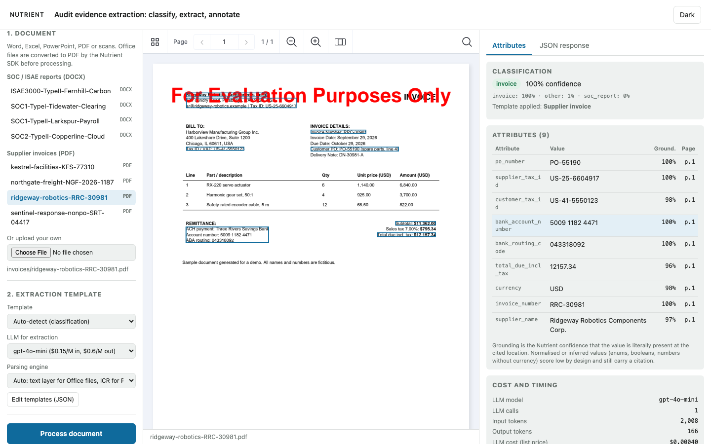
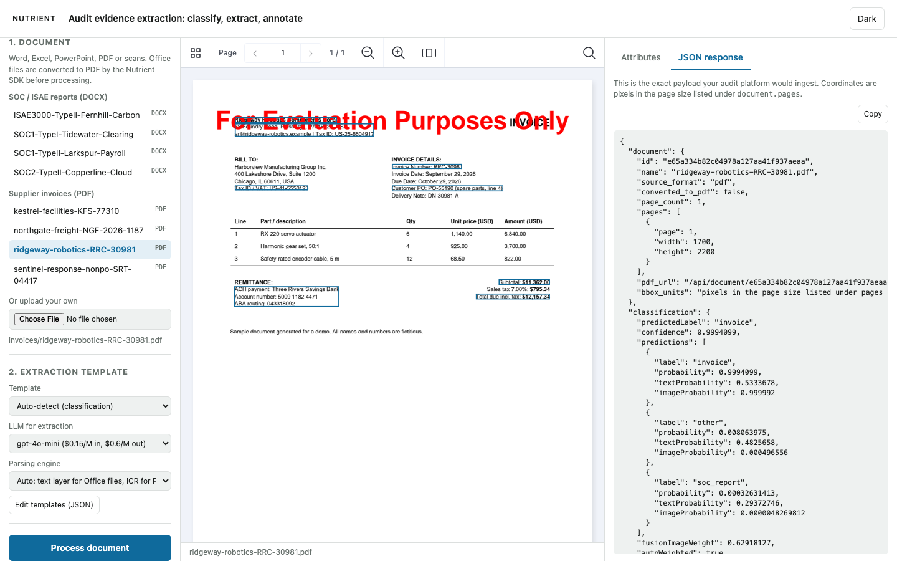
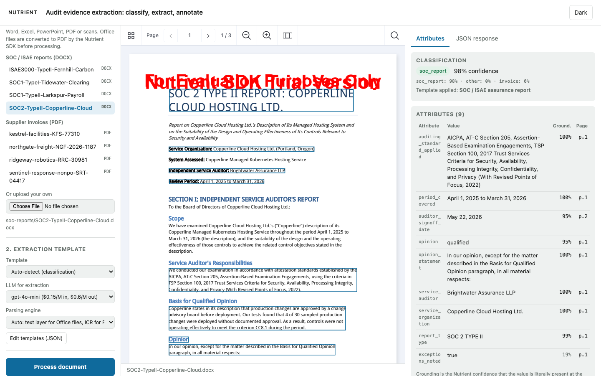

# Nutrient Audit Evidence Extraction

A Nutrient.io demo that classifies an audit evidence document, extracts the attributes an audit platform needs, and returns each value with a confidence score and the coordinates of the evidence in the document.



1. **Convert.** Word, Excel, PowerPoint, PDF or scanned images. The Nutrient Python SDK converts Office files to PDF locally.
2. **Parse.** The SDK reads the text layer (adaptive OCR) or runs its ICR vision model on every page. It returns text and word coordinates. This step runs locally.
3. **Classify.** Zero-shot classification in the SDK picks `soc_report`, `invoice` or `other`. This step runs locally, without an LLM.
4. **Extract.** The SDK structured extraction sends the document text and a JSON schema to an OpenAI-compatible LLM. The schema is built from the attribute list of the template that matches the class.
5. **Return JSON.** For each attribute: the value, a grounding confidence, the page and the bounding box of the evidence.
6. **Review.** The Nutrient Web SDK shows the converted PDF with one rectangle per attribute. Clicking a row in the attribute table jumps to its evidence.

Only step 4 calls an LLM, plus step 2 when you pick the ICR + VLM engine. The LLM is OpenAI, or a local model served by Ollama, so no data has to leave the machine.

## Prerequisites

- Python 3.12 or later
- macOS on Apple Silicon or Linux x86_64 (the Nutrient Python SDK native runtimes)
- About 1 GB of disk space for the ICR models. The SDK downloads them into `~/.local/share/Nutrient` on the first run.
- An OpenAI API key, or Ollama with a local model such as `qwen2.5:7b-instruct`
- Optional: Docker

## Environment variables

Copy `.env.example` to `.env` and fill in what you need. Keys are only read from environment variables, never from code.

| Variable | Purpose | Default |
|---|---|---|
| `NUTRIENT_PYTHON_LICENSE_KEY` | Nutrient Python SDK license key | empty = evaluation mode |
| `NUTRIENT_WEB_SDK_LICENSE_KEY` | Nutrient Web SDK license key, served to the browser by `GET /api/config` | empty = evaluation mode |
| `OPENAI_API_KEY` | OpenAI key for the extraction step. Not needed for Ollama models | empty |
| `OPENAI_TEXT_MODEL` | Default extraction model | `gpt-4o-mini` |
| `OLLAMA_URL` | Ollama server. Its models appear in the model list with the prefix `ollama:` | `http://127.0.0.1:11434` |
| `LOCAL_MAX_TOKENS` | `max_tokens` added to requests sent to Ollama | `1500` |
| `LOCAL_PRESENCE_PENALTY` | `presence_penalty` added to requests sent to Ollama | `0.6` |
| `PORT` | Server port | `8010` |
| `ALLOWED_ORIGINS` | CORS origins, comma separated | `http://localhost:8010,http://127.0.0.1:8010` |
| `WORK_DIR` | Folder for the converted PDFs | `nutrient-audit-evidence-poc` in the system temp folder |
| `NUTRIENT_METADATA_SCHEMA` | Version of the extraction metadata. `2` adds the grounding score | `2` |
| `NUTRIENT_VLM_FULL_PAGE` | `1` sends the full page image with each VLM request | `0` |

Without an LLM, the app still converts, parses and classifies documents, and `POST /api/process` returns a clear error at the extraction step.

## Build and run

```bash
cp .env.example .env
```

```bash
./run.sh
```

Open <http://localhost:8010>.

`run.sh` creates `.venv`, installs `requirements.txt` on the first run, loads `.env` and starts uvicorn. The viewer loads the Nutrient Web SDK 1.22.0 from `https://cdn.cloud.pspdfkit.com/pspdfkit-web@1.22.0/`.

### With Docker

```bash
docker build -t nutrient-audit-evidence-extraction .
```

```bash
docker run --rm -p 8010:8010 --env-file .env nutrient-audit-evidence-extraction
```

### With a local model (Ollama)

```bash
ollama pull qwen2.5:7b-instruct
```

```bash
OLLAMA_KEEP_ALIVE=-1 ollama serve
```

Pick `qwen2.5:7b-instruct via Ollama` in the model list. Requests go through the same local proxy, so tokens are still counted and the cost is zero. `OLLAMA_KEEP_ALIVE=-1` keeps the model loaded: a reload after Ollama's idle timeout can exceed the SDK timeout. On an Apple Silicon laptop, a sample report with the text-layer engine took about 70 s and a one-page invoice with ICR about 3 minutes. A 7B model is weaker than `gpt-4o-mini`; a 14B or larger model closes most of the gap.

## Using the app

1. Pick a sample on the left, or upload a document. The original opens in the viewer.
2. Choose a template. **Auto-detect** classifies the document first and picks the template.
3. Choose the LLM and the parsing engine:
   - **Auto**: text layer for Office files, ICR for PDFs and images.
   - **Text layer**: reads the PDF text and runs OCR only on pages without text. Fast.
   - **ICR**: runs the vision model on every page. Use it for scans and complex layouts.
   - **ICR + VLM**: adds a VLM pass per page. It uses many more tokens.
4. Click **Process document**. The step list shows convert, parse, classify, extract and annotate.
5. The **Attributes** tab lists each value with its grounding score and page. Click a row to jump to the evidence. The **JSON response** tab shows the payload your application would ingest.
6. **Edit templates (JSON)** lets you add or reword attributes for this session. **Download annotated PDF** saves the PDF with the rectangles.





The screenshots were taken in evaluation mode, so the viewer and the converted PDF carry an evaluation watermark.

Grounding is the SDK's confidence that the value is printed at the cited location. Normalized values (an enum like `opinion`, a boolean, a number without its currency symbol) score low by design and still carry a citation. `opinion_statement` keeps the verbatim sentence for the audit trail. When a value is missing, the JSON carries `null` rather than a guess.

## Templates

A template is a list of attributes. Each attribute has a name, a JSON type and a description in plain English. The JSON schema sent to the SDK is generated from this list, see [app/templates.py](app/templates.py).

| Template | Attributes |
|---|---|
| `soc_report` | auditing standard applied, period covered, auditor sign-off date, opinion, opinion statement, service auditor, service organization, report type, exceptions noted |
| `invoice` | PO number, supplier tax ID, customer tax ID, bank account number, bank routing code, total due including tax, currency, invoice number, supplier name |

## API

| Method and path | Description |
|---|---|
| `GET /api/config` | `{ web_sdk_license_key, model, models, pricing, openai_configured, samples }` |
| `GET /api/templates` | `{ classification_labels, templates }`, the default catalog |
| `GET /api/sample/{category}/{name}` | A bundled sample. `category` is `soc-reports` or `invoices` |
| `POST /api/process` | Multipart form, see below. Returns the extraction JSON |
| `GET /api/document/{id}.pdf` | The converted PDF the coordinates refer to |

`POST /api/process` fields:

| Field | Values |
|---|---|
| `file` | The document. Or `category` and `sample` for a bundled sample |
| `template` | `auto` (classify first, default), `soc_report`, `invoice`, or any id from `templates_json` |
| `templates_json` | Optional. A full template catalog to use instead of the defaults |
| `model` | Optional. LLM model for the extraction step, for example `gpt-4o-mini` or `ollama:qwen2.5:7b-instruct` |
| `engine` | `auto` (default), `adaptive`, `icr` or `vlm` |

Response, abridged:

```json
{
  "document": { "id": "…", "name": "sentinel-response-nonpo-SRT-04417.pdf", "source_format": "pdf",
                "converted_to_pdf": false, "page_count": 1,
                "pages": [{ "page": 1, "width": 1700, "height": 2200 }],
                "pdf_url": "/api/document/….pdf" },
  "classification": { "predictedLabel": "invoice", "confidence": 0.83, "predictions": [ … ] },
  "template": { "id": "invoice", "label": "Supplier invoice" },
  "attributes": [
    { "name": "po_number", "value": null,
      "confidence": { "parse": null, "grounding": null }, "citation": null },
    { "name": "bank_account_number", "value": "7730418826",
      "confidence": { "parse": null, "grounding": 0.999 },
      "citation": { "page": 1, "bbox": { "x": 176, "y": 939, "width": 668, "height": 52 } } }
  ],
  "usage": { "model": "ollama:qwen2.5:7b-instruct", "calls": 2, "input_tokens": 2852, "output_tokens": 1962, "cost_usd": 0.0 },
  "engine": "ICR",
  "timings_ms": { "convert": 1, "parse": 1715, "classify": 1091, "extract": 189088 }
}
```

Coordinates are in the page size listed under `document.pages`; scale them to your renderer. `parse` is the OCR score and is only set for scanned input.

## Samples

`samples/soc-reports` holds four fictitious assurance reports (SOC 1 Type I, SOC 1 Type II, SOC 2 Type II with a qualified opinion, ISAE 3000 Type II). `samples/invoices` holds four fictitious supplier invoices: with a PO and an IBAN, without a PO, with an account and routing number, and a milestone invoice with retainage. To regenerate them:

```bash
pip install -r samples/requirements.txt
```

```bash
python samples/generate_samples.py
```

## Layout

| Path | Role |
|---|---|
| `app/main.py` | FastAPI routes |
| `app/pipeline.py` | Convert, parse, classify, extract, build the JSON |
| `app/templates.py` | Classification labels and extraction templates |
| `app/nutrient_engine.py` | Nutrient Python SDK calls: license, parsing, classification, structured extraction |
| `app/vlm_proxy.py`, `app/usage.py`, `app/pricing.py` | Local proxy in front of the LLM that counts tokens and cost per run |
| `web/` | UI: Nutrient Web SDK viewer, attribute table, JSON tab |
| `samples/` | Sample documents and their generator |
